# FHOOD — API de experiência do paciente

API da demonstração acadêmica para a Fundação Hospitalar Dr. Oswaldo Diesel. Coleta avaliações anônimas e integra triagem, gestão de questionários, escala mensal e indicadores, com contato voluntário separado.

[Aplicação](https://fhdod-ouvidoria-demo.vercel.app) · [Swagger](https://fhdod-ouvidoria-demo.onrender.com/api-docs/) · [Saúde](https://fhdod-ouvidoria-demo.onrender.com/health) · [Frontend de demonstração](https://github.com/ariannedemattos-aam/Frontend-fhod/tree/deploy/demo)



## Arquitetura

Node.js, Express, Zod, MySQL 8.4 por mysql2, Socket.IO, JWT, bcrypt, OpenAPI/Swagger, ExcelJS e PDFKit. `controllers/` e `services/` implementam regras e consultas. `routes/` e `middlewares/` aplicam autenticação e validação. `database/` e `scripts/` contêm SQL de base, migrations e seed de demonstração. `swagger/` mantém o contrato. `tests/` mantém unitários e roteiro de integração com fixtures.

O Render hospeda a API e o Aiven armazena o schema demonstrativo. A Vercel hospeda a web. Cinco perfis têm permissões distintas. A API reforça escopo por setor, sessão atual, rotação, revogação, hash de senhas e auditoria de contatos. TLS valida o certificado do Aiven. Contatos ficam no retorno opcional; o TV Wall recebe agregados. Consulte a [documentação de segurança](docs/seguranca-e-nuvem.md) para limites.

## Instalação local

Use Node.js (a entrega foi verificada com Node 24), npm e MySQL 8.4. Crie `.env` privado a partir de [`.env.example`](.env.example) e aponte para um banco local descartável. Separe as chaves de JWT e refresh e nunca versionize o arquivo real. Para instalação use conta DDL no banco local. Em operação use conta DML do schema. Os arquivos de configuração indicam URL do frontend, CORS, demonstração de comunicação e TLS.

```sh
npm ci
npm run migrate
npm run seed:demo
npm start
```

Preencha `ADMIN_PASSWORD` e `SECTOR_PASSWORD` localmente antes do seed. Ele cria contas fictícias sem redefinir senhas já existentes. Para testes locais, abra `http://localhost:3000/api-docs/`. A URL pode variar com `PORT`. Mantenha o Aiven fora de instalações descartáveis. Consulte [padrões de banco](docs/padroes-banco-de-dados.md).

## Testes

```sh
npm test
npm run test:coverage -- --coverageReporters=text-summary --coverageReporters=json-summary
```

A suíte unitária verifica regras, contrato OpenAPI e parâmetros. O roteiro de integração `node tests/integration/operations.mjs` usa exclusivamente a demonstração autorizada com TLS e arquiva os registros fictícios. A cobertura unitária mede 37,05% de linhas. Resultados e escopo em [Testes](docs/plano-e-relatorio-de-testes.md).

## Documentação técnica

1. [Requisitos](docs/requisitos.md)
2. [Arquitetura do backend](docs/arquitetura-backend.md)
3. [Padrões Git e autoria](docs/padroes-git.md)
4. [Plano e relatório de testes](docs/plano-e-relatorio-de-testes.md)
5. [Modelo e requisitos de dados](docs/modelo-de-dados-e-requisitos.md)
6. [Padrões de banco](docs/padroes-banco-de-dados.md)
7. [Mapeamento e consultas](docs/mapeamento-classes-e-consultas.md)
8. [Segurança e nuvem](docs/seguranca-e-nuvem.md)

[Diagramas editáveis e SVGs](docs/diagramas/) · [Guia do Swagger](docs/integration.md) · [Kanban retrospectivo](docs/kanban-retrospectivo.md) · [Capturas no frontend](https://github.com/ariannedemattos-aam/Frontend-fhod/tree/deploy/demo/docs/capturas)

A demonstração é de uma instituição. A arquitetura pode ser reproduzida para outra em ambiente segregado. O uso institucional e a avaliação manual com leitor de tela exigem validação própria.

**Créditos** — Arianne Arruda de Mattos e Igor Gabriel Morgenstern. Consulte o registro de autoria no Git e no `.mailmap`.
